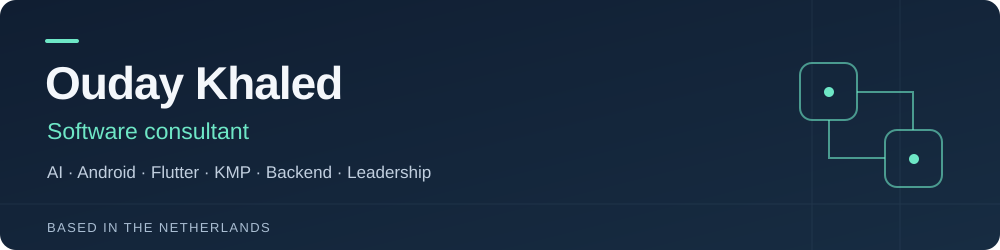

  <a href="https://ouday-khaled.netlify.app/">Portfolio</a> &nbsp;·&nbsp;
  <a href="https://www.linkedin.com/in/oudaykhaled/">LinkedIn</a> &nbsp;·&nbsp;
  <a href="https://medium.com/@ouday.khaled">Writing</a> &nbsp;·&nbsp;
  <a href="mailto:ouday.khaled@gmail.com">Get in touch</a>

### Software that works beyond the happy path

I'm a software consultant based in the Netherlands, with engineering experience since 2013 across digital banking, payments and enterprise software. I connect architecture with hands-on implementation: reusable components, clear system boundaries, reliable delivery and teams that can maintain what they build.

Currently **Senior Android Engineer at BUUT (ABN AMRO)**. Previously **Mobile Principal Engineer and Chapter Lead at Backbase**, working on modular banking components, mentoring engineers and collaborating across product and QA.

### What I bring

- **Mobile engineering:** Kotlin, Java, Jetpack Compose, coroutines and Flow; modular architecture, offline workflows and lifecycle recovery.
- **Backend and integration experience:** C#/.NET, SQL, APIs and enterprise systems, complemented by public work in messaging and distributed systems.
- **Technical leadership:** architecture reviews, chapter leadership, mentoring, hiring and collaboration from design through release.
- **Engineering quality:** unit and UI testing, CI/CD, code review and documentation that makes decisions easy to inspect.

### Selected public work

These demos, prototypes and reference projects make the engineering decisions visible. Each repository documents its own setup and scope.

| Project | What to look for | Explore |
| --- | --- | --- |
| **[TransferFlow](https://github.com/oudaykhaled/TransferFlow)** · Kotlin / Compose | A synthetic banking demo focused on exact money, durable request state and safe retries after an uncertain transfer outcome. | [Two-minute walkthrough](https://github.com/oudaykhaled/TransferFlow/blob/main/docs/demo-guide.md) · [Verification](https://github.com/oudaykhaled/TransferFlow/blob/main/docs/verification.md) |
| **[BoundaryLab](https://github.com/oudaykhaled/boundarylab)** · Kotlin / Flutter / C++ | Bounded middleware across Android and JVM clients, plus a separate native Binder service prototype in a source-built Android 16 image. | [Architecture](https://github.com/oudaykhaled/boundarylab/blob/main/docs/AOSP-LAYERS.md) · [Evidence gallery](https://github.com/oudaykhaled/boundarylab/blob/main/docs/SHOWCASE.md) |
| **[MiniBank](https://github.com/oudaykhaled/mini-bank)** · Go / Java / Rust | A money-transfer reference architecture exploring saga orchestration, Kafka, gRPC, idempotency and observability. | [Design decisions](https://github.com/oudaykhaled/mini-bank#design-decisions) |
| **[Flutter News Reader](https://github.com/oudaykhaled/nyt-flutter-clean-architecture-unit-test)** · Dart / Flutter | A BLoC and Clean Architecture sample with unit and integration tests, coverage tooling and a Bitrise pipeline. | [Architecture and testing guide](https://github.com/oudaykhaled/nyt-flutter-clean-architecture-unit-test#app-architecture) |

<strong>A closer look: recovering a transfer after a lost response</strong>

TransferFlow preserves the original request when a response is lost, then recovers the outcome using the same idempotency key. The demo uses synthetic accounts and makes no real payments.

  

### Let's connect

Interested in opportunities where hands-on engineering, architecture and technical leadership come together. For relevant roles or a conversation about my work, reach me on **[LinkedIn](https://www.linkedin.com/in/oudaykhaled/)** or **[email](mailto:ouday.khaled@gmail.com)**.
